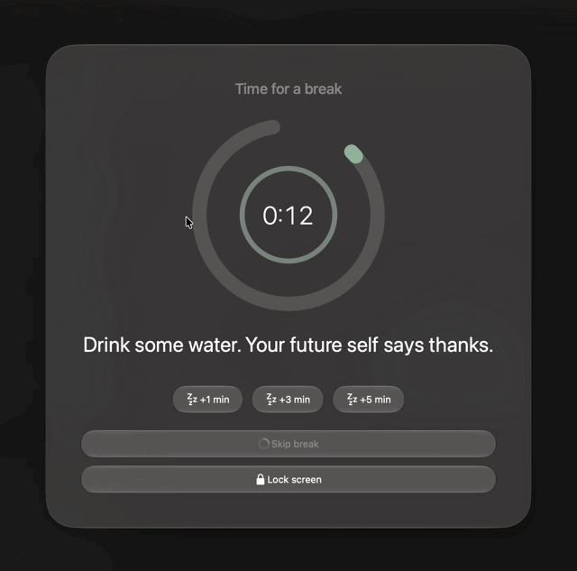
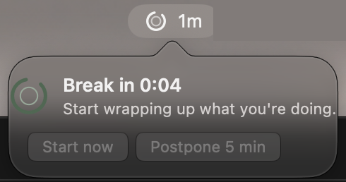
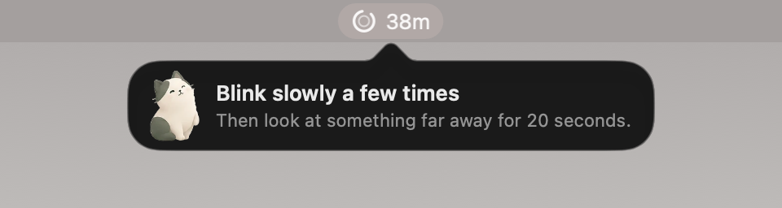
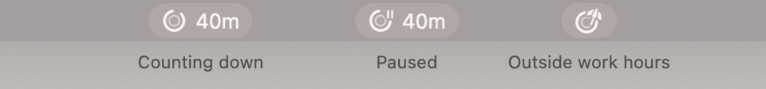
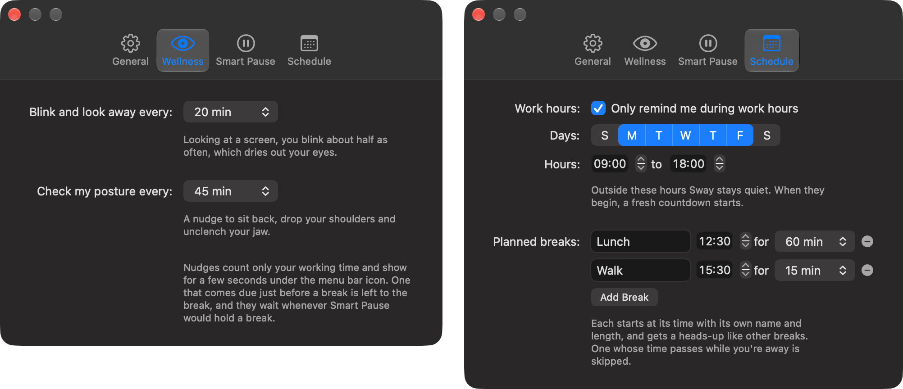

  

# Sway

*Find your flow.*

A small macOS menu bar app that reminds you to take breaks.

Designed to encourage you to respect your time.

  

  

  

  

  

## Features

- **A cat to keep you company**: Sway's mascot works beside you in the menu, stretches when a break is near and through the break itself, and cheers when it's over.
- **Menu bar countdown** to your next break, shown as hours and minutes (`1h20m`, `40m`). A tiny pause badge appears on the logo while paused, and outside work hours the countdown gives way to a beach umbrella.
- **Live menu header** with a rolling countdown and buttons to add 1, 5 or 15 minutes.
- **Heads-up popover** before each break (configurable: off, 30 sec, 1/2/5 min or custom), with *Start now* and the same +1/+3/+5 min snooze as the break overlay.
- **Full-screen break overlay** on every display, fading in and out:
  - the primary display shows the Sway logo filling up as the break runs, a random calming message, snooze buttons (+1/+3/+5 min), *Skip break* (available after 5 seconds) and *Lock screen*;
  - other displays are just blurred.
- **Gentle sounds**: a soft chime for the heads-up, a calm arpeggio as the break starts and a bright little run when it's over, with an on/off switch and volume in Settings. They're synthesized by `tools/sounds.swift`.
- **Liquid Glass** styling on macOS 26+, including a layered glass app icon; older systems get the standard look.
- **Good-morning greeting**: the first time you're back on a new day, the excited cat greets you with a motivational message and the countdown starts fresh.
- **A welcome on first launch** walks you through picking your work interval and break length in a few steps.
- **Pauses while you're away**: after 30 seconds without keyboard, mouse or trackpad input the countdown stops (adjustable or off), and when you're back a popover says how long you were gone.
- **Keeps counting through calls and videos**: with the microphone or camera in use, or an app keeping the screen awake for a video or slideshow, the countdown keeps going without input, and a break that comes due during a call waits until it ends. Each activity, plus music and other audio, can be turned on or off in Settings.
- **Waits for a good moment**: a break that comes due while you're typing or dragging waits for a short pause (up to a minute), and one that comes due in a full-screen app or in a focus app you pick waits until you leave it. Each can be turned on or off.
- **Work hours**: optionally, Sway only runs on the days and hours you work, stays quiet outside them and starts a fresh countdown when they begin. *Start reminders anyway* in the menu overrides it until the next workday.
- **Long breaks**: optionally, one break in every few (2 to 6) runs longer, say 15 minutes, so you can get up and walk around. The heads-up and the menu say when the next one is long, and a lunch or a long time away counts as one.
- **Blink and posture nudges**: optionally, a small popover under the menu bar icon reminds you to blink and look into the distance, or to check your posture, every so often between breaks. They count only working time; one that comes due just before a break is left to the break, and they wait whenever Smart Pause would hold a break (a call, a focus app).
- **Planned breaks** at set times, such as lunch at 12:30 for an hour or a walk at 15:30, each with its own name and length and a heads-up like any other break.
- **Work interval and break length** right in the menu, and a **Settings window** (gear icon in the menu) with *General* (work interval, break length, long breaks, heads-up, sounds, language, *Launch at Login*), *Wellness* (blink and posture nudges), *Smart Pause* (away detection and when to hold breaks) and *Schedule* (work hours and planned breaks) tabs, all saved between launches. Sleep or a locked screen counts as a break.
- Available in English, Português (Brasil), Español, Français, Deutsch, Italiano, 日本語, 한국어 and 简体中文, following your Mac's language or the one you pick in Settings.

  

## Requirements

- macOS 13 or later (Liquid Glass on macOS 26+)
- Xcode, for `swiftc` and `actool` (the icon compiler)

## License

Sway is open source under the [MIT License](LICENSE).

## Support

Sway is free and always will be. If it helps you take better breaks and you’d like to say thanks, you can...

