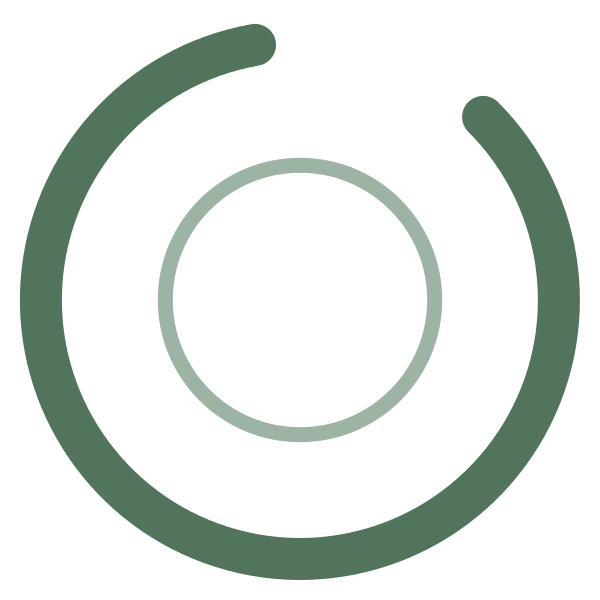

  

# Sway

A small macOS menu bar app that reminds you to take breaks.

Designed to encourage you to respect your time.

## Features

- **Menu bar countdown** to your next break, shown as hours and minutes (`1h20m`, `40m`). A tiny pause badge appears on the logo while paused.
- **Live menu header** with a rolling countdown and buttons to add 1, 5 or 15 minutes.
- **Heads-up popover** before each break (configurable: off, 30 sec, 1/2/5 min or custom), with *Start now* and *Postpone 5 min*.
- **Full-screen break overlay** on every display, fading in and out:
  - the primary display shows the Sway logo filling up as the break runs, a random calming message, snooze buttons (+1/+3/+5 min), *Skip break* (available after 5 seconds) and *Lock screen*;
  - other displays are just blurred.
- **Liquid Glass** styling on macOS 26+, including a layered glass app icon; older systems get the standard look.
- Configurable work interval and break length, saved between launches. Sleep or a locked screen counts as a break.
- Optional *Launch at Login*.

## Requirements

- macOS 13 or later (Liquid Glass on macOS 26+)
- Xcode, for `swiftc` and `actool` (the icon compiler)

## Support

Sway is free and always will be. If it helps you take better breaks and you’d like to say thanks, you can...

